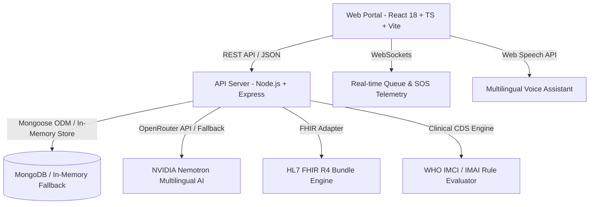

# 🏥 ArogyaLink (आरोग्यलिंक) — Smart Rural Healthcare Access & Clinical Pathway Platform

> **Smart India Hackathon 2026 · Problem Statement 26133 · MoHFW & National Health Mission (NHM)**  
> An integrated, standards-based digital health coordination platform designed for underserved, tribal, and rural communities. Aligned with **Ayushman Bharat Digital Mission (ABDM)** and **HL7® FHIR® R4** standards.

---

## 📌 Executive Summary

Rural healthcare delivery in India faces a dual challenge: **geographical isolation** leading to high out-of-pocket travel costs, and **fragmented care pathways** that overload district hospitals while primary health centres remain underutilized.

**ArogyaLink** connects citizens, frontline ASHA/CHW workers, Primary Health Centres (PHC), and tertiary District Hospitals into a unified, intelligent healthcare coordination loop. Featuring the lightweight multilingual **NVIDIA Nemotron / Clinical Decision Support** AI engine, real-time hospital capacity matching, Hub-and-Spoke diagnostic transit, and offline-first data synchronization, ArogyaLink transforms primary healthcare access across India.

---

## 🚀 Quick Start Guide (Run with 1 Command)

ArogyaLink is engineered for **100% zero-friction execution**. It includes built-in in-memory fallbacks, so **it runs immediately out-of-the-box even without MongoDB installed!**

### Option A: Windows (One Click / Single Command)
Simply double-click `start.bat` or run in terminal:
```cmd
start.bat
```

### Option B: Linux / macOS (Single Command)
```bash
chmod +x start.sh
./start.sh
```

### Option C: Standard NPM Monorepo Command
```bash
# 1. Install dependencies
npm install

# 2. Start both Backend (:4000) and Web Portal (:3000) concurrently
npm run dev
```

Once started:
- 🌐 **Web Portal:** [http://localhost:3000](http://localhost:3000)
- 🔌 **API Server:** [http://localhost:4000](http://localhost:4000)
- 🩺 **Health Check:** [http://localhost:4000/api/health](http://localhost:4000/api/health)

---

## 📱 Easy Sharing: Access from Another Laptop or Smartphone on Wi-Fi / LAN

You can share your live ArogyaLink instance with a friend, team member, or jury without deploying to the cloud:

### Step 1: Find Your Local IP Address
- **On Windows:** Open Command Prompt or PowerShell and run:
  ```cmd
  ipconfig
  ```
  Look for `IPv4 Address` under your active Wi-Fi / Ethernet adapter (e.g. `192.168.1.45`).
- **On Linux / macOS:** Run:
  ```bash
  ip route get 1.2.3.4 | awk '{print $7}'
  # or
  ifconfig
  ```

### Step 2: Open on Friend's Laptop or Phone
Ensure both devices are connected to the same Wi-Fi network or mobile hotspot. On the second laptop or mobile browser, open:
```
http://<YOUR_LOCAL_IP>:3000
```
*(Example: `http://192.168.1.45:3000`)*

> **Why it works seamlessly:** The frontend dynamically resolves backend API and WebSocket endpoints using `window.location.hostname`, and Vite dev server is configured with `host: 0.0.0.0` and proxy routing to Express on port 4000.

---

## 🌐 Optional Nginx Reverse Proxy Setup

An enterprise-ready `nginx.conf` is included in the project root for deploying behind Nginx or exposing on port 80:

```bash
# Copy or link nginx.conf into your Nginx configuration
nginx -c "$(pwd)/nginx.conf"
```
This routes:
- `/` $\to$ Web Portal (`http://127.0.0.1:3000`)
- `/api/` $\to$ Backend REST API (`http://127.0.0.1:4000/api/`)
- `/ws` $\to$ Live WebSocket server (`ws://127.0.0.1:4000`)

---

## 🎯 Core End-to-End Workflows & Features

### 1. Patient / Citizen Flow
1. **Symptom Reporting & Clinical Analyse:**
   - Select common rural symptoms (Fever, Breathing Difficulty, Swelling, Headache, etc.) or type clinical complaints in English, Marathi, Hindi, Telugu, or Kannada.
   - Click **Clinical Analyse** to receive instant clinical assessment, triage level (Emergency, Urgent, Routine), red flags, and recommended department.
2. **Prioritized Health Facilities & M/M/c Queue Estimates:**
   - View nearest Primary Health Centres, Community Health Centres, and District Hospitals ranked by multi-criteria priority score (Equipment match 35%, Distance 30%, Bed availability 20%, Wait time 15%).
3. **Pre-Arrival OP Token Booking:**
   - Click **Book OP Token** on any facility to get an instant digital token number and estimated consultation wait time.
   - The token and encounter are automatically recorded in the patient's **ABHA Longitudinal Health Record**.
4. **My Health Record (ABHA Timeline):**
   - View complete digital history of all clinical encounters, OP tokens, e-prescriptions, medicine deliveries, and referrals.

### 2. PHC Medical Officer Flow
1. **Live OPD Queue Board:**
   - View patients waiting in line sorted by clinical urgency and token number.
2. **Clinical Review & Teleconsultation:**
   - Review patient vitals, symptom history, and connect with specialist doctors via integrated teleconsultation.
3. **Referral Initiation:**
   - Create 5-stage closed-loop referrals to higher secondary/tertiary hospitals with ambulance assignment.

### 3. Specialist Doctor & Hospital Flow
1. **Patient Chart & Longitudinal History:**
   - Inspect full patient timeline, observations, and diagnostic history.
2. **e-Prescription Generation:**
   - Select patient, add medications with dosage, route, frequency, and duration.
   - Click **Save & Issue Prescription** to commit to the patient's ABHA record and generate a printable/downloadable PDF format.

### 4. Frontline ASHA / CHW Flow
1. **High-Risk Patient List:**
   - Track high-risk maternal ANC/PNC and non-communicable disease (NCD) patients.
2. **PoCT Vitals Intake:**
   - Record blood pressure, pulse, SpO2, temperature, and blood glucose.
3. **Offline Sync Panel:**
   - Works fully offline with local IndexedDB/LocalStorage queueing and delta sync with clinician conflict protection when network reconnects.

### 5. Hospital Administrator & Resource Management
1. **Live Bed & Resource Snapshots:**
   - Update and monitor ICU beds, general beds, oxygen availability, and emergency bays in real time.
2. **Inbound Referral Reception & Triage:**
   - Accept incoming emergency transfers and assign green channel priority.

---

## 🛠️ Technology Architecture



---

## 📁 Repository Structure (Turborepo Monorepo)

```
sih-2026-model/
├── apps/
│   ├── api-server/                 # Express REST & WebSocket Backend (:4000)
│   │   ├── src/
│   │   │   ├── ai/                 # NVIDIA Nemotron & In-Memory CDS Ranker
│   │   │   ├── middleware/         # Auth, RBAC, Rate Limiting, CORS
│   │   │   ├── models/             # Mongoose Longitudinal Data Models
│   │   │   ├── services/           # CDS Engine & FHIR R4 adapters
│   │   │   ├── seedData.js         # Realistic clinical cohorts & facility data
│   │   │   └── server.js           # Express server & API endpoints
│   │   └── package.json
│   └── web-portal/                 # React + TypeScript Frontend Application (:3000)
│       ├── src/
│       │   ├── components/shared/  # OPBooking, VoiceBar, SideNav, Header
│       │   ├── views/              # Patient, ASHA, PHC, Hospital, Doctor, Admin Views
│       │   ├── lib/                # API client, Voice assistant, Translation
│       │   ├── store/              # User session & offline stores
│       │   └── App.tsx             # Main view router & role shell
│       └── package.json
├── package.json                    # Root workspaces & Turbo pipeline
├── start.bat                       # One-click Windows runner
├── start.sh                        # Single-command Linux/macOS runner
├── nginx.conf                      # Nginx reverse proxy configuration
├── .env.example                    # Sample environment variables
└── README.md                       # Master documentation
```

---

## 🔑 Environment Variables Reference

Copy `.env.example` to `.env` if you want to customize ports or configure OpenRouter API keys:

| Variable | Default | Purpose |
|---|---|---|
| `PORT` | `4000` | Backend API Server port |
| `MONGODB_URI` | `mongodb://127.0.0.1:27017/arogyalink` | MongoDB connection URI |
| `VITE_API_URL` | `http://localhost:4000` | Frontend API base URL |
| `NEMOTRON_ENABLED` | `true` | Enables AI Clinical Decision Support |
| `OPENROUTER_API_KEY` | *(Configured)* | OpenRouter API Key for Nemotron model |
| `CORS_ORIGINS` | `http://localhost:3000` | Allowed CORS origins |

---

## 🧪 Validation & Type Checking

To verify the codebase integrity across all packages:
```bash
# Type check all TypeScript apps and packages
npm run typecheck

# Production build test
npm run build
```

---

## 📜 Compliance & Clinical Standards

- **ABDM (Ayushman Bharat Digital Mission):** 14-digit ABHA ID integration and consent-governed health records.
- **HL7® FHIR® R4:** Standardized schemas for `Patient`, `Encounter`, `Observation`, `Condition`, `MedicationRequest`, and `ServiceRequest`.
- **WHO Guidelines:** Integrated IMCI (Childhood Illness) and IMAI (Adult Illness) triage rules.
- **MoHFW Dakshata Protocol:** High-risk maternal health and pre-eclampsia danger sign prioritization.

---

## 📄 License & Attribution

Developed for **Smart India Hackathon 2026** under the **National Health Mission (MoHFW)**.  
All rights reserved © 2026 ArogyaLink Contributors.
